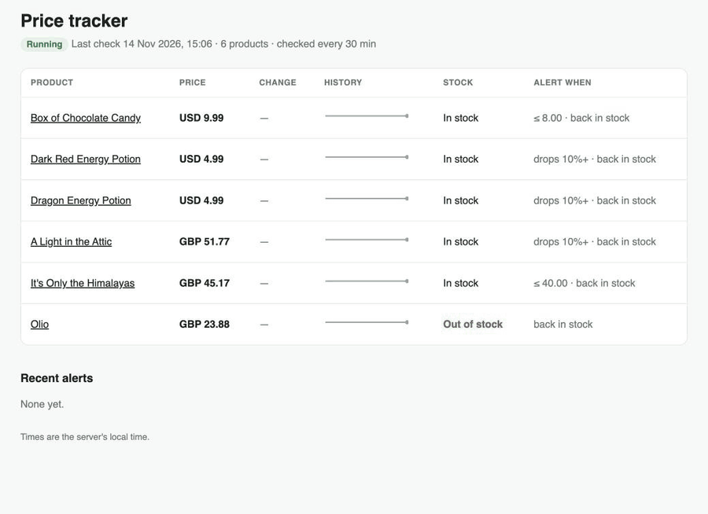

# Price tracker

[](https://github.com/diegoharroyo/price-tracker/actions/workflows/ci.yml)
[](https://diegoharroyo.github.io/price-tracker/)

Watches product pages around the clock, keeps every price in a small database, and sends a Telegram message
when a price drops below your target, falls by a set percentage, or an item comes back in stock.
Runs unattended on any Linux server or a Raspberry Pi, with a dashboard and a health check.



*The drop in the recording is simulated: the pages are real, saved copies with the prices edited (`fixtures/`).*
**[Live dashboard](https://diegoharroyo.github.io/price-tracker/)**: the same code checking the real pages every 6 hours.

## What it does

- Reads a list of product pages from `watchlist.toml`, each with its own alert rule.
- Alerts on Telegram when a price reaches your target, drops by X % or more since the last check,
  or an item is back in stock. Each alert fires once, when it happens, not on every check while it's true.
- Keeps the full price history in SQLite. Optionally mirrors it to a Google Sheet:
  a **Latest** tab with today's prices and an **Alerts** tab with everything that was sent.
- Warns you when a page fails 3 checks in a row (the shop moved the page or changed its layout),
  and if the tracker itself crashes.
- Dashboard with every product, its price history and the recent alerts, plus `/health` for an uptime monitor.
- Polite: follows each site's robots.txt, waits between requests, identifies itself.

## Run it

You need [uv](https://docs.astral.sh/uv/).

```sh
uv sync
uv run tracker.py --fixtures fixtures/t0 --db demo.db   # check the saved pages
uv run tracker.py --fixtures fixtures/t1 --db demo.db   # same pages after a simulated drop: 3 alerts
PRICES_DB=demo.db uv run dashboard.py                   # http://localhost:8000
```

Drop `--fixtures` and `--db` to check the real pages (history goes to `prices.db`). Without Telegram settings, alerts are printed.
For Telegram, create a bot with [@BotFather](https://t.me/BotFather), copy `.env.example` to `.env`, fill it in,
and run `uv run --env-file .env tracker.py`.

## Run it 24/7

`deploy/` has systemd units for a Linux server (any VPS, or a Raspberry Pi at home):

| Unit | What it does |
|---|---|
| `price-tracker.timer` | runs a check every 30 minutes, and catches up after the machine was off |
| `price-tracker.service` | one check of every page |
| `price-tracker-failed.service` | sends you a Telegram if a check run fails |
| `price-tracker-dashboard.service` | the dashboard, restarted automatically if it crashes or is killed |

```sh
sudo useradd --system --create-home pricetracker
sudo git clone https://github.com/diegoharroyo/price-tracker /opt/price-tracker
cd /opt/price-tracker && sudo cp .env.example .env && sudo nano .env
sudo chown -R pricetracker: /opt/price-tracker && sudo chmod 600 /opt/price-tracker/.env
sudo -u pricetracker uv sync --no-dev     # uv must be on that user's PATH
sudo cp deploy/*.service deploy/*.timer /etc/systemd/system/
sudo systemctl enable --now price-tracker.timer price-tracker-dashboard.service
sudo systemctl start price-tracker.service   # first check now, not at the next :00 or :30
```

The dashboard listens on 127.0.0.1:8000. Put it behind your reverse proxy or a VPN rather than opening the port.

Tested on a fresh Debian 12 VM with these steps (uv installed to `/usr/local/bin`). Killing the dashboard brings it back on its own:

```
$ sudo systemctl kill price-tracker-dashboard
$ systemctl status price-tracker-dashboard
● price-tracker-dashboard.service - Price tracker dashboard
     Active: active (running) since Sat 2026-11-14 15:41:09 -03; 1s ago
$ curl localhost:8000/health
{"ok":true}
```

and a run that crashes sends `⚠️ Price tracker crashed on <hostname>. Your developer can see why with: journalctl -u price-tracker -n 50`.

## Adapt it to your store

- **What to watch:** edit `watchlist.toml`. Every `[[item]]` is a URL with optional `below` and `drop_pct`.
- **Most shops need no per-site code.** Shopify, WooCommerce and many other platforms publish product data for
  Google (schema.org JSON-LD), and the default parser reads that. Many big stores rate-limit bots, though;
  those need their official API or product feed, or their permission.
- **A site without it** gets a small parser: a function in `parsers.py` that returns name, price, currency and
  stock, mapped to its domain in `PARSERS`. `books_toscrape` is an example.
- **How often:** `OnCalendar` in `deploy/price-tracker.timer`, and `CHECK_EVERY_MIN` in `.env` to match.

## Limits

- Pages that only show the price after running JavaScript need a headless browser (Playwright), not included.
- Sites behind bot protection (Cloudflare challenges, CAPTCHAs) or that disallow it in robots.txt are not
  checked. Neither are pages behind a login.
- One price per page. For products with variants it takes the cheapest, and counts as in stock if any variant is.
- No currency conversion. Each product is compared with its own past prices.

## Tests

```sh
uv run pytest
uv run ruff check .
```

Parsers run on the saved pages in `fixtures/`, alert rules are pure functions, and an end-to-end test runs
the tracker on `t0` then `t1` in an in-memory database. Nothing touches the network, so CI runs on every push.

---

MIT license.
